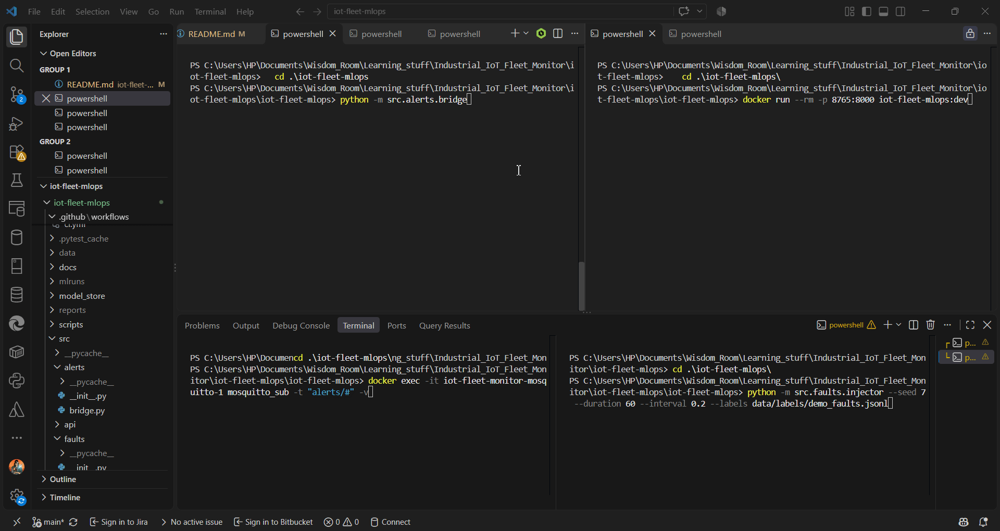
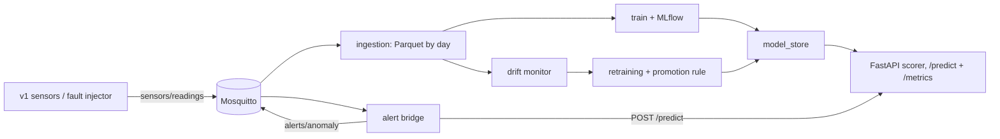
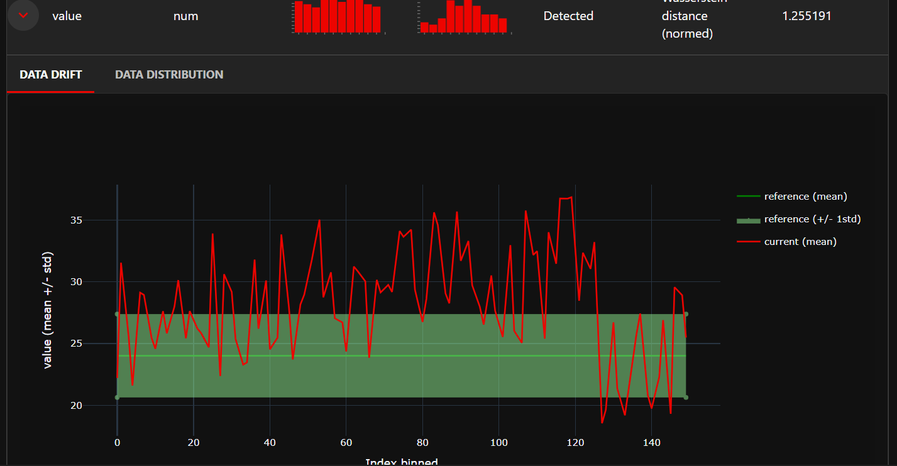
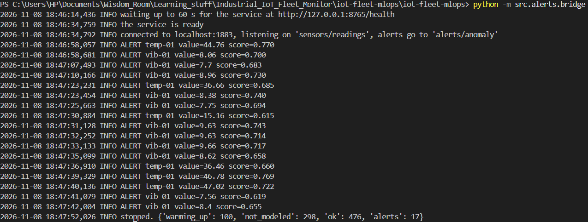

# iot-fleet-mlops 


Closed-loop MLOps for IoT fleets: drift detection, automatic retraining, and
shadow-mode rollout, built on top of [iot-fleet-monitor](https://github.com/Xbalawi/iot-fleet-monitor) v1.0.

**Status:** Week 2 done: baseline model, MLflow tracking, Dockerised service with CI, drift monitoring, retraining with a promotion rule, alerts back to MQTT and service metrics. Next (Week 3): shadow-mode rollout with automatic rollback, validation on a real dataset, public deployment.

## Demo



About 2 minutes, in this order:

1. The alert bridge starts first and waits until the scoring service answers `/health`.
2. The fault injector sends 60 s of readings at 15 messages per second, with labelled faults.
3. Alerts appear on `alerts/anomaly` within a fraction of a second.
4. `/metrics` shows the time spent per call and the age of every reading.
5. The drift report, and the retraining pipeline deciding whether a new model is good enough to replace the current one.

## How it works



The project consumes the MQTT stream of [iot-fleet-monitor](vendor/iot-fleet-monitor) (v1, included as a submodule). A fault injector adds labelled faults (spikes, slow drift, dropouts), so every model can be graded against ground truth.

## Quickstart (live demo)

```bash
git clone --recurse-submodules https://github.com/Xbalawi/iot-fleet-mlops.git
cd iot-fleet-mlops
pip install -r requirements.txt

# 1. the broker, from v1
cd vendor/iot-fleet-monitor && docker compose up -d mosquitto && cd ../..

# 2. the bridge first (leave it running): it waits for the service to be ready
python -m src.alerts.bridge

# 3. the scoring service (another terminal)
docker build -t iot-fleet-mlops:dev .
docker run --rm -p 8765:8000 iot-fleet-mlops:dev

# 4. watch the alerts (another terminal)
docker exec -it iot-fleet-monitor-mosquitto-1 mosquitto_sub -t "alerts/#" -v

# 5. once the bridge says "connected": inject faults for 60 s (another terminal)
python -m src.faults.injector --seed 7 --duration 60 --interval 0.2 --labels data/labels/demo_faults.jsonl
```

Reproduce the models: record data with `python -m src.ingestion.subscriber` and the injector, train with `python -m src.model.train`, browse runs with `mlflow ui --backend-store-uri sqlite:///mlflow.db --port 5001`, and export a run with `python -m src.model.export <run_id>`.

## What it detects

One Isolation Forest per sensor type (temperature, vibration) on rolling-window features. Windows only look at past readings, so a spike cannot pull its own baseline up and hide. The service computes the features with the same definition as training, and a test compares the two.

Replaying 4,378 recorded readings through the running service:

| Fault | Rows scored | Caught | Recall |
|---|---|---|---|
| Spike | 49 | 43 | 0.878 |
| Slow drift | 357 | 7 | 0.020 |

Precision 0.862, false alarm rate 0.003. Dropouts are caught by a separate rule on the gap between readings (a reading arriving more than 3x later than usual), because a missing row cannot be scored: 16 of 16, with 0 false alarms and no training needed.

The forest misses slow drift by design: drift is a distribution change, not a point anomaly. That is the job of the drift monitor below.

## Drift monitoring and retraining

The model judges one reading at a time, so it misses slow drift (2% recall). A drift monitor watches the distribution instead.

- **Detection.** A two-sample KS test (p < 0.001) compares each window of 100 readings with known-good reference data. On the labelled test run it catches 3 of 4 drift windows with 0 false alarms in 24 clean windows. An [Evidently](https://www.evidentlyai.com/) report is generated for the strongest drift window.
- **Trigger.** Drift is not always a reason to retrain: here a drift is a sensor fault, and a model retrained on faulty readings would learn that the fault is normal. So retraining needs sustained drift: at least 2 of a sensor's last 5 windows.
- **Candidate.** New models trained only on the recent readings, for the triggered sensor types.
- **Promotion rule.** The candidate and the current model are scored on held-out labelled data. The candidate may not lose more than 0.02 recall or raise the false alarm rate by more than 0.005, and it needs a real gain: at least `max(0.02, 2 / validation spikes)` recall, or a 0.002 drop in false alarms. With about 23 validation spikes, one extra spike is inside the noise and is rejected.
- Every attempt is logged to MLflow with the decision and its reasons.



```bash
python -m src.model.drift              # grade the monitor against the labels
python -m src.model.report             # save an Evidently report for the strongest drift window
python -m src.model.pipeline           # retrain only if drift is sustained, and print the decision
python -m src.model.pipeline --force   # judge a candidate even without drift
python -m src.model.pipeline --apply   # if promoted, replace the models in model_store/
```

## Alerts back to MQTT

`python -m src.alerts.bridge` reads `sensors/readings`, asks the service for a score, and publishes anomalies to `alerts/anomaly` (QoS 1):

```json
{"kind": "anomaly", "sensor_id": "temp-01", "type": "temperature", "value": 44.76,
 "timestamp": "2026-11-08T18:46:57.999871+00:00", "score": 0.7701782976746245,
 "detected_at": "2026-11-08T18:46:58.057666+00:00"}
```

In the demo run (seed 7, 15 messages per second) all 17 alerts were published between 0.06 and 0.24 s after the reading's own timestamp, with a median of 0.08 s.

It waits for the service's `/health` before it subscribes, counts scoring errors instead of crashing, and prints its stats when stopped. Configuration is by environment variables (see the top of `src/alerts/bridge.py`).



## Service metrics and performance

`GET /metrics` exposes request counts by status, anomalies, the time spent inside the service per call, and the age of each reading when it arrives (Prometheus text format, no extra dependency).

That last metric exposed a real problem. At 15 messages per second (about 17 times v1's real rate) the alerts arrived up to a minute late. Profiling showed the cost was the Isolation Forest being evaluated twice per reading, plus a whole pandas pipeline to compute one row of features. Fixing both, with tests that keep the results identical:

| Same demo (seed 7, 60 s, 15 messages/s) | Before | After |
|---|---|---|
| Time per scored reading in the service (estimated from the totals) | ~150 ms | ~59 ms |
| Mean age of a reading when scored | 12.9 s | 0.08 s |
| Readings older than 30 s | 8% | 0 |
| Delay from reading to alert | 6 s growing to 76 s (in a 120 s run) | 0.06 to 0.24 s |

Reproduce the profile with `python -m scripts.profile_scorer`.

## Known limits

- **Outages lose readings.** If the service goes down after startup, the bridge counts the failed readings and moves on; there is no retry or buffer.
- **One worker, on purpose.** The scorer keeps each sensor's recent readings in memory, so the service runs a single worker and answers requests one at a time.
- **Reading age compares clocks.** The metric subtracts the reading's timestamp from the service's clock. For replays of recorded data it shows how old the recording is, not lag.
- **Synthetic faults.** All results are on injected faults from the v1 simulator. Validation on a real public dataset is on the roadmap.
- **The bridge only hears what is published after it subscribes.** Readings sent while it waits for the service are not delivered to it at all.

## Built on iot-fleet-monitor v1.0

The v1 project is included as a submodule, pinned at `v1.0`, and is never modified.
This repo only talks to it through MQTT.

```bash
git clone --recurse-submodules <url>
```

or, after a normal clone:

```bash
git submodule update --init
```

### How the two repos connect

```
 iot-fleet-monitor (v1.0)             iot-fleet-mlops (this repo)
 ┌─────────────────────┐   MQTT    ┌─────────────────────────────────┐
 │ Mosquitto broker    │──────────▶│ subscriber ─▶ Parquet (by day)  │
 │ Flask + dashboard   │           │                                 │
 └─────────────────────┘           │ fault injector ─▶ MQTT          │
            ▲                      │        └─▶ labels (faults.jsonl)│
            └── sensors/readings ──┴─────────────────────────────────┘
```

v1's simulator is replaced by the fault injector during experiments. It publishes the
same messages, with faults injected on purpose.

## Experiment tracking

Every training run is recorded in MLflow (parameters, metrics and the trained models):

    python -m src.model.train
    mlflow ui --backend-store-uri sqlite:///mlflow.db --port 5001

Then open http://localhost:5001.

**Takeaway:** a point-anomaly model catches sudden faults but is blind to slow drift, which is why the drift monitor above exists.


## Collecting training data

```bash
pip install -r requirements.txt
python -m pytest
```

1. Start v1's broker and backend, and stop its simulator so there is only one publisher:

```bash
   cd vendor/iot-fleet-monitor
   docker compose up -d
   docker compose stop simulator
```

2. Terminal A, the subscriber (stop it with Ctrl+C, which flushes what is buffered):

```bash
   python -m src.ingestion.subscriber
```

3. Terminal B, the fault injector (5 minutes, 5 ticks per second):

```bash
   python -m src.faults.injector --seed 42 --duration 300 --interval 0.2
```

## Serving

Export the models of a training run, build the image, and start the service:

    python -m src.model.export <run_id>
    docker build -t iot-fleet-mlops:dev .
    docker run --rm -p 8765:8000 iot-fleet-mlops:dev

- `GET /health` shows the loaded models and the run they came from.
- `GET /metrics` shows counters and timings (see "Service metrics and performance").
- `POST /predict` scores one reading (`sensor_id`, `type`, `value`, `timestamp`).
  A sensor answers `warming_up` until it has 50 previous readings.
- `http://127.0.0.1:8765/docs` is an interactive test page.


Replay a recorded run through the service and grade it:

    python -m src.api.replay

The replay gives exactly the offline results (spike 43/49, drift 7/357), which shows
that serving and training compute the same features.


**Design choices**
- The scorer computes one reading's features with a fast numpy function (`last_row_features`) instead of the training pipeline. Tests compare it with `add_features` on random data, short histories and flat windows, so the two cannot drift apart.
- The service runs a single worker, because each sensor's recent readings are kept in memory.
- The image does not contain MLflow: training exports the models to `model_store/`, and the service reads that folder.

| Setting | Where | Default |
|---|---|---|
| `BROKER_HOST`, `BROKER_PORT` | env, both programs | `localhost`, `1883` |
| `TOPIC`, `DATA_DIR`, `FLUSH_ROWS`, `FLUSH_SECONDS` | env, subscriber | `sensors/readings`, `data/raw`, `50`, `30` |
| `--seed`, `--duration`, `--interval`, `--labels` | injector arguments | `42`, required, `3.5`, `data/labels/faults.jsonl` |
| `SERVICE_URL`, `HEALTH_URL`, `WAIT_FOR_SERVICE`, `ALERT_TOPIC` | env, bridge | `http://127.0.0.1:8765/predict`, derived from `SERVICE_URL`, `60`, `alerts/anomaly` |

## Data

Topic `sensors/readings`, one JSON message per reading:

```json
{"sensor_id": "temp-01", "type": "temperature", "value": 19.48,
 "timestamp": "2026-10-13T13:46:14.769256+00:00"}
```

- **Readings:** `data/raw/date=YYYY-MM-DD/readings-<timestamp>.parquet`, partitioned by the UTC day of the
  reading and written in batches. Read them all with `pd.read_parquet("data/raw")`.
- **Labels (ground truth):** `data/labels/faults.jsonl`, one fault per line with `sensor_id`, `fault_type`,
  `start` and `end`. Labels are never sent over MQTT, so a model cannot see them.
- Readings and labels are paired. To start a clean experiment, delete `data/raw` and `data/labels` together.

## Fault injection

| Fault | Applies to | Behaviour |
|---|---|---|
| Spike | temperature, vibration | One reading outside the normal range. Temperature: 31-39 or 11-17 (inside v1's static limits, so only a model can catch them) or 41-50 (v1 catches these). Vibration: 6-10. |
| Drift | temperature | 150 readings with an offset growing by 0.05 per reading (up to about +7.5 °C) on top of the normal noise. Stays inside v1's limits. |
| Dropout | all sensors | No readings for 10 ticks. |

Normal ranges are copied from v1: temperature 18-30, vibration 0-5, occupancy 0 or 1.
Each tick, a healthy sensor starts a spike with probability 0.02, and a drift or dropout with
probability 0.002 each. All randomness comes from `random.Random(seed)`.

Example run (300 s, `--interval 0.2`): 61 faults (50 spikes, 8 dropouts, 3 drifts) and 4,387 readings,
which equals 3 sensors x 1,489 ticks minus 8 dropouts x 10 readings.

## Design decisions

- **Labels stay out of the stream.** The injector writes them to a separate file, so a model cannot cheat.
- **Seeded randomness.** The same seed gives the same fault sequence.
- **Time compression.** `--interval` makes training data in minutes instead of hours.
- **No silent data loss.** The injector waits for the broker connection and exits with code 1 if there is none.
  The subscriber rejects and counts malformed messages instead of crashing.
- **Logic is separate from I/O.** The parser, the store and the fault state machine are plain functions and classes, so the unit tests run in seconds without a broker.

## Roadmap

- [x] Repo, v1 submodule, MQTT subscriber, Parquet storage
- [x] Fault injector with ground-truth labels
- [x] Rolling-window features and Isolation Forest baseline
- [x] MLflow tracking, FastAPI serving in Docker, CI with GitHub Actions
- [x] Drift monitoring and drift-triggered retraining with a promotion rule
- [x] Alerts back to MQTT and service metrics
- [ ] Shadow-mode rollout with automatic rollback
- [ ] Validation on a real public dataset
- [ ] Public deployment